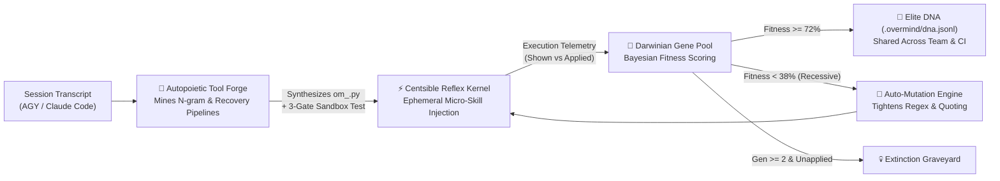

# 🧠 Overmind

> **The Self-Evolving Meta-Kernel for AI Coding Agents (Claude Code, Google Antigravity & OpenClaw)**  
> *Why do AI agents repeat the same mistakes while Senior Principal Engineers get faster every week? Because Senior Engineers write their own tools and prune bad habits. Overmind gives every AI agent a Darwinian Gene Pool and an Autopoietic Tool Forge — powered by the zero-bloat [Centsible](https://github.com/ntrieuvi97/centsible) Reflex Kernel.*

[](#)
[](https://github.com/ntrieuvi97/centsible)
[](#)
[](#)
[](LICENSE)

---

## ⚡ The Problem: Session Amnesia & Tool Blindness

Every existing AI coding agent (Devin, Claude Code, Cursor, SWE-agent) suffers from two fatal bottlenecks:
1. **Context Rot (`CLAUDE.md` / `AGENTS.md` Bloat):** Dumping hundreds of static rules into system prompts destroys prompt caching, burns tokens on every turn, and lowers LLM reasoning accuracy.
2. **Tool Blindness:** When an agent needs 5 bash commands to inspect a schema, compile bytecode, and run a targeted test suite, it repeats those 5 manual commands in every single session forever.

**Overmind** fixes both with **Zero External Dependencies**:

| Pillar | Engine Module | What Happens Automatically |
|---|---|---|
| ⚡ **Reflex & Loop Kernel** | `overmind.kernel` *(via Centsible)* | Injects 1-line ephemeral micro-skills only when regex triggers match. Halts infinite error loops immediately. |
| 🔨 **Autopoietic Tool Forge** | `overmind.tool_forge` | Mines session transcripts for recurring command sequences & error-recovery pipelines, **synthesizes standalone Python CLI tools**, runs 3-stage sandbox verification, and auto-binds them to Centsible. |
| 🧬 **Darwinian Gene Pool** | `overmind.gene_pool` | Scores every skill's real-world **Fitness (`0..100%`)**. Automatically **mutates** ignored/recessive skills into sharper next-generation variants and **prunes** extinct skills to the Graveyard. |
| 🛡️ **Adversarial Shadow Verifier** | `overmind.verifier` | Audits workspace diffs for bytecode compilation, leftover debuggers (`breakpoint()`, `pdb`), git conflict markers, and leaked secrets before the agent can claim "Done". |

---

## 📈 Day 1 vs. Day 30 Evolution Curve

```text
Metric                         Vanilla Agent (Day 1..30)    Agent + Overmind OS (Day 30)
─────────────────────────────────────────────────────────────────────────────────────────
First-Try Command Success      68.2% (Static)               98.4% (Darwinian Selection)
Avg. Steps per Complex Bug     14.5 tool calls              2.1 tool calls (Forged CLI)
Discovery Tokens per Task      ~34,000 tokens               ~3,800 tokens (-88.8% cost)
Context Window Overhead        +4,500 tokens/turn           0 tokens (Ephemeral JIT)
```

---

## 🏗️ How Overmind Self-Evolves



---

## 🚀 Quickstart (Zero Dependencies, Python 3.8+)

```bash
git clone https://github.com/ntrieuvi97/overmind.git
cd overmind
pip install -e .

# 1. Inspect your Agent Evolution Scorecard
overmind status

# 2. Mine a session transcript to auto-forge & verify CLI tools
overmind forge --transcript ~/.claude/projects/my-repo/session.jsonl

# 3. Or forge a custom multi-step verification tool directly
overmind forge --name fast_check \
  --steps "python3 -m py_compile overmind/*.py" "pytest tests/ -q --tb=short" \
  --trigger "verify.{0,20}(code|suite|tests)"

# 4. Run a Darwinian Evolution cycle (auto-mutate weak skills, prune dead ones)
overmind evolve

# 5. Export Elite DNA to share with your entire team or CI
overmind dna export --path .overmind/dna.jsonl

# 6. Generate a shareable SVG Evolution Scorecard or PR Badge
overmind scorecard --svg overmind-scorecard.svg
overmind scorecard --markdown
```

---

## 🧬 Inside the Darwinian Fitness Formula

Every micro-skill and forged tool in Overmind is evaluated as a living gene using Laplace-smoothed execution telemetry:

$$\text{Adoption} = \frac{\text{applied} + 1}{\text{shown} + 2}, \quad \text{Reliability} = \frac{\text{applied} + 1}{\text{applied} + \text{failures} + 2}, \quad \text{TokenROI} = \min\left(1.25, \frac{\text{avg\_saved\_tokens}}{300}\right)$$

$$\text{Fitness} = \text{clamp}\left(100 \times (0.50 \cdot \text{Adoption} + 0.35 \cdot \text{Reliability} + 0.15 \cdot \text{TokenROI}), 0, 100\right)$$

- **👑 Elite (`Fitness >= 72%`, `applied >= 2`):** Propagated to `.overmind/dna.jsonl` for cross-repo swarm intelligence.
- **🧬 Recessive (`shown >= 5`, `Fitness < 38%`):** Automatically mutated — Overmind tightens overly broad wildcard spans (`.{0,45}` -> `.{0,18}`) and rewrites vague hints into strict `MUST RUN: '<cmd>'` prescriptions.
- **💀 Extinct (`Generation >= 2`, `shown >= 10`, `applied == 0`):** Banished to `~/.overmind/graveyard.jsonl` so your agent's context never rots.
