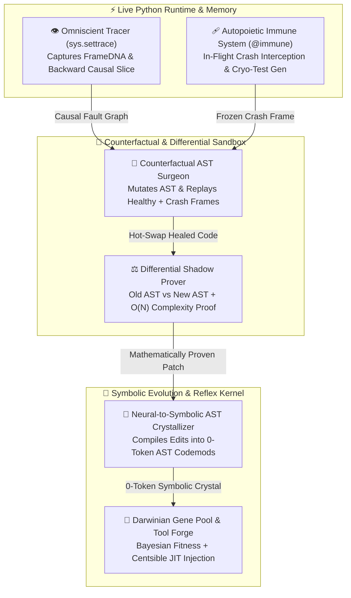

# 🧠 Overmind 2.0: The Omniscient Autopoietic Kernel

> **Beyond Static Text Guessing — The World's First Runtime-Omniscient, Self-Healing, Mathematically Proven & Self-Crystallizing OS for AI Coding Agents**  
> *Why do every existing AI agent (Devin, Claude Code, Cursor, SWE-agent) still need human Senior Engineers? Because they read static text files like blind men reading Braille, guess what happens in memory, write shallow tests, and burn thousands of LLM tokens repeating the same code edits. **Overmind 2.0** hooks directly into the live Python runtime and AST compiler to end the Static Text Era.*

[](#)
[](https://github.com/ntrieuvi97/centsible)
[](#)
[](#)
[](LICENSE)

---

## ⚡ Why Current AI Agents Fail vs. Overmind 2.0

Every multi-agent swarm, git-worktree runner, and Spec-to-PR wrapper built so far operates on **dead static text**. Overmind 2.0 introduces **4 Runtime & Compiler Breakthroughs** with **Zero External Dependencies**:

| Breakthrough Pillar | Engine Module | What Current Agents Do (Static Era) | What Overmind 2.0 Does (Omniscient Era) |
|---|---|---|---|
| 👁️ **1. Omniscient Runtime Tracer & Causal Fault Graph** | `overmind.omniscient` | Grep files, read 10,000 tokens of text, *guess* what variables held at crash time. | Hooks `sys.settrace` to record live `FrameDNA` variable mutations & runs **Backward Dynamic Slicing** to isolate the exact root-cause line and state transition. |
| 🩹 **2. In-Flight Self-Healing Immune System** | `overmind.immune` | Process crashes -> waits hours for human bug report -> human prompts LLM -> LLM guesses a fix. | `@immune` intercepts unhandled crashes **in-flight**, cryo-freezes the call frame into a `pytest` regression test, tests candidate **AST Surgeries** in-memory against all historical healthy frames, and hot-swaps the healed code without crashing! |
| ⚖️ **3. Behavioral Invariant Miner & Differential Shadow Prover** | `overmind.prover` | Relies on human Code Review because unit tests miss edge cases, argument mutation, or $O(N^2)$ slowdowns. | Mines **Daikon-style Behavioral Contracts** & empirical step complexity (`O(1)`, `O(N)`, `O(N^2)+`), running **Old-AST vs. New-AST Differential Shadow Execution** to mathematically prove zero regression. |
| 💎 **4. Neural-to-Symbolic AST Crystallizer** | `overmind.crystallizer` | Burns 2,000+ LLM tokens every time a similar code pattern needs refactoring across files. | Abstracts neural code edits (`Before AST -> After AST`) into metavariable templates (`__OM_V1__`) and compiles them into **0-token Symbolic AST Codemods** executing in `<2ms`. |

Plus Overmind's battle-tested **Darwinian Gene Pool** (`overmind.gene_pool`), **Autopoietic CLI Tool Forge** (`overmind.tool_forge`), and **Adversarial Shadow Verifier** (`overmind.verifier`).

---

## 🏗️ Architecture: The 4 Omniscient Pillars



---

## 🌍 Universal Installation & 1-Command Repo Onboarding (`overmind init`)

### Step 1: Install Overmind Globally (Any Machine / CI)

**Option A — 1-Line Universal Installer (macOS / Linux / WSL):**
```bash
curl -fsSL https://raw.githubusercontent.com/ntrieuvi97/overmind/main/install.sh | bash
```

**Option B — via `pip` / `pipx` / `uv`:**
```bash
pip install git+https://github.com/ntrieuvi97/overmind.git
# or: pipx install git+https://github.com/ntrieuvi97/overmind.git
```

### Step 2: Onboard Any Repository in the World (`overmind init`)

Navigate to **any repository** and run:
```bash
cd /path/to/any-repo
overmind init
```

`overmind init` automatically scaffolds 4 layers into the target repository so every developer, AI agent, and CI pipeline shares the same Omniscient Kernel:
1. **`.overmind/dna.jsonl`** — Version-controlled Team Elite DNA store.
2. **`.git/hooks/pre-commit`** — Automatically applies 0-token Symbolic AST Crystals (`overmind crystallize --apply .`) and runs `overmind verify` before every commit.
3. **`.github/workflows/overmind.yml`** — GitHub Actions PR gate that imports `.overmind/dna.jsonl`, runs `overmind verify --run-tests`, and posts the **Overmind Evolution Scorecard** to the PR Summary.
4. **Multi-Agent Workspace Rules:**
   - **Claude Code:** `.claude/settings.json` (`Stop` lifecycle hook)
   - **Cursor:** `.cursor/rules/overmind.mdc`
   - **Google Antigravity:** `.agent/rules/overmind.md`

---

## 🚀 Core Workflows & Live Demonstrations (Zero Dependencies)

### 1. 👁️ Omniscient Runtime Tracer & Causal Fault Localization
Stop guessing why code crashed. Trace live variable mutations and get a deterministic Backward Causal Slice:
```bash
overmind trace path/to/buggy_script.py
```

### 2. 🩹 In-Flight Self-Healing Immune System (`@immune` & `overmind heal`)
Equip any function to heal itself in-flight without crashing, automatically generating a `pytest` regression test and verifying zero regression across all historical healthy frames:
```python
from overmind import immune

@immune(auto_heal=True, persist_test=True)
def calculate_conversion(conversions: int, visitors: int) -> float:
    return conversions / visitors

# 1. Healthy calls teach Overmind the ground-truth behavioral contract:
assert calculate_conversion(50, 200) == 0.25

# 2. Unhandled ZeroDivisionError is intercepted in-flight!
# Overmind synthesizes an AST guard `(conversions / visitors if visitors != 0 else 0.0)`,
# verifies it against (50, 200) -> 0.25, writes a pytest regression test, hot-swaps the AST in memory,
# and returns 0.0 without crashing:
assert calculate_conversion(10, 0) == 0.0
```
Or heal an entire script from the CLI:
```bash
overmind heal app.py --apply
```

### 3. ⚖️ Differential Shadow Prover (Mathematical Replacement for Code Review)
Mine behavioral contracts and prove whether an AI refactor preserves exact semantics, argument purity, dict schemas, and $O(N)$ algorithmic complexity:
```bash
# Mine invariants & empirical O(1) / O(N) / O(N^2)+ complexity
overmind prove --mine overmind/gene_pool.py

# Prove equivalence & catch O(N) -> O(N^2) regressions between two versions
overmind prove --before old_impl.py --after new_impl.py
```

### 4. 💎 Neural-to-Symbolic AST Crystallizer (0-Token, `<2ms` Codemods)
Compile any recurring code fix into a reusable, metavariable-abstracted Symbolic AST Crystal:
```bash
# Crystallize a neural code edit into a deterministic AST transformer
overmind crystallize --name safe_subprocess_timeout \
  --before "subprocess.run(cmd, check=True)" \
  --after "subprocess.run(cmd, check=True, timeout=30)"

# Apply all compiled AST Crystals across an entire repository in <2ms with 0 LLM tokens!
overmind crystallize --apply src/
```

### 5. 📊 Evolution Scorecard & Darwinian Selection
```bash
overmind status
overmind evolve
overmind scorecard --svg overmind-scorecard.svg
```
