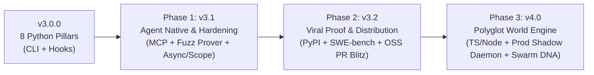

# 🧠 Overmind Roadmap: From v3.0 Kernel to Post-Developer World Engine

> **Mission:** Obsolete manual "static-text guessing" software development and out-execute every static AI coding wrapper (Devin, Cursor, Claude Code, SWE-agent) by making **Runtime Omniscience, Mathematical Proof, Time-Travel I/O, and Autonomous Optimization** the mandatory execution layer for all software.

---

## 📍 Current Baseline (`v3.0.0`)

- **Core Implemented:** All 8 Singularity Pillars (`omniscient`, `immune`, `prover`, `crystallizer`, `alchemist`, `chronos`, `synthesizer`, `hive`) + `kernel`, `gene_pool`, `tool_forge`, `initializer`, `scorecard`, `verifier`, and `overmind update`.
- **Verification:** `19/19` tests passing (`python3 -m pytest -q`), zero external runtime dependencies (100% Python stdlib).
- **Critical Bottlenecks Blocking Real-World Dominance:**
  1. **No MCP Server (`overmind mcp`):** Agents still default to `grep` + file reads because Overmind is only exposed via CLI (`overmind/cli.py`) and `Stop` hooks (`hooks.json`).
  2. **Template & Sample Ceilings:** `synthesizer.py` uses ~50 hardcoded expressions; `alchemist.py` covers 4 AST patterns; `prover.py` checks 7 hardcoded domain samples (`synthesize_domain_inputs`), risking missed edge cases.
  3. **Silent Fallback Risk:** `immune.py` surgeons inject silent defaults (`0.0`, `None`, `""`) without a PR/shadow-only policy gate for strict business/financial logic.
  4. **Scope & I/O Limits:** `hive.py` drops cross-module name collisions (`ambiguous_names`) and skips classes/methods/import aliases; `chronos.py` lacks `async def`, `requests`/`httpx`, `datetime.now`, `sqlite3`/`psycopg`, and file I/O interception.
  5. **Python-Only & Unbenchmarked:** ~75% of commercial dev uses TypeScript/JS, Go, Rust, or SQL; Overmind has no published SWE-bench delta or PyPI package yet.

---

## 🗺️ Execution Trajectory

---

## 🚀 Phase 1: Agent-Native Oracle & Production Hardening (`v3.1`)

**Goal:** Ensure no real-world Python repo or AI coding agent can dismiss Overmind as a single-file/template toy, and force AI agents to run through Overmind natively.

- [x] **1.1 Zero-Dependency MCP Server (`overmind mcp`)**
  - Implement a stdlib JSON-RPC `stdio` MCP server in `overmind/mcp_server.py` (newline-delimited & `Content-Length` framed).
  - Expose native agent tools: `overmind_status`, `overmind_trace`, `overmind_prove`, `overmind_optimize`, `overmind_synthesize`, `overmind_hive`, `overmind_chronos`, `overmind_crystallize`, `overmind_verify`.
  - Wire into Antigravity, Claude Code (`.mcp.json`), and Cursor (`.cursor/mcp.json`) generated by `overmind init` (`overmind/initializer.py`).
- [x] **1.2 Property-Based Fuzzing Prover (`overmind/prover.py`)**
  - Expand `synthesize_domain_inputs` from 7 static inputs to **100+ randomized + boundary-adversarial property inputs** (empty, duplicates, negative/zero/NaN, dicts, Unicode, ordering sensitivity).
  - Add strict type/NaN-aware differential parity & complexity checks.
- [x] **1.3 Hybrid Neural-Symbolic CEGIS (`overmind/synthesizer.py`)**
  - Allow external LLM/agent candidate AST proposals (`candidate_sources`) to be piped into CEGIS + `BehavioralInvariantMiner` + complexity gates (`O(N)` max), with multi-statement synthesis and optional auto-crystallization into `SymbolicCrystal`s.
- [x] **1.4 Policy-Gated Immune System (`overmind/immune.py`)**
  - Add explicit modes: `--mode shadow-pr` (generate cryo-test + verified `.diff` patch while re-raising loudly) vs. `--mode safe-fallback` (in-flight survival mode).
- [x] **1.5 Multi-File Symbol Resolution in Hive (`overmind/hive.py`)**
  - Build a real import, alias, class-method, and parameter-kind resolver (`ast.Import`, `ast.ImportFrom`, relative imports, `Class.method`, `self.method`, positional-only & keyword-only params) instead of dropping cross-module `ambiguous_names`.
- [x] **1.6 Async & Production I/O Virtualization in Chronos (`overmind/chronos.py`)**
  - Support `async def` coroutines, `datetime.now/utcnow`, `uuid.uuid4`, `requests`/`httpx` (when loaded), `sqlite3`, `subprocess.run`, and scoped read-only `open()` virtualization into `ExecutionCassette`s.

**Exit Gate:** Overmind runs cleanly via `overmind mcp` inside Antigravity/Claude Code and passes end-to-end tests on a multi-file async FastAPI + SQLite app.

---

## 🌍 Phase 2: Viral Proof, Distribution & OSS Wedge (`v3.2`)

**Goal:** Replace claims with hard public benchmarks, zero-friction installation, and real merged PRs across major open-source repositories.

- [ ] **2.1 Self-Dogfooding ("Eat Your Own Kernel")**
  - Run `overmind init`, `overmind verify`, `overmind hive`, `overmind optimize`, and `overmind crystallize` on the `overmind` repository itself; replace zeroed telemetry (`0 AST Crystals`, `0 Self-Heals`) with live verified evolutions.
- [ ] **2.2 PyPI & `uvx` Publishing (`overmind-os`)**
  - Publish `overmind-os` to PyPI via GitHub Actions tag workflow so users run `uvx overmind-os init` or `pip install overmind-os` without git-URL friction.
- [ ] **2.3 SWE-bench Verified Showdown**
  - Run reproducible head-to-head benchmarks on **SWE-bench Verified** (e.g., 50–100 tasks):
    - Baseline LLM Agent vs. Baseline LLM Agent + `overmind mcp`
  - Publish exact deltas: **1st-try pass rate**, **tokens burned**, **wall-clock solve time**, and **regressions caught**.
- [ ] **2.4 The "Alchemist OSS PR Blitz"**
  - Scan top 50 Python open-source repos (`pydantic`, `fastapi`, `httpx`, `rich`, etc.) with `overmind optimize` + `overmind prove`.
  - Submit high-signal PRs fixing verified $O(N^2)$ hotspots with attached `DifferentialShadowProver` equivalence tables and speedup metrics.
- [ ] **2.5 Zero-Config GitHub PR Bot (`overmind-gate`)**
  - Package `overmind` as a GitHub Action / App that automatically comments on PRs with complexity alerts (`O(N) -> O(N^2)+` blocked), `Hive` caller drift warnings, and `Chronos` reproducer cassettes.

**Exit Gate:** `overmind-os` live on PyPI, public SWE-bench Verified report published in `README.md`, and >=10 verified external OSS PRs merged.

---

## ⚡ Phase 3: Overmind 4.0 — The Post-Developer World Engine (`v4.0`)

**Goal:** Expand beyond Python into the full global software stack and close the loop from production telemetry directly to autonomous PRs.

- [ ] **3.1 Polyglot Core — TypeScript / Node.js Adapter (First Non-Python Runtime)**
  - AST & Call-Graph Hive over the **TypeScript Compiler API** (covers ~80% of modern startup/web codebases).
  - Runtime Tracer & Chronos Time-Travel over the **V8 Inspector / Chrome DevTools Protocol (CDP)** + `vitest`/`jest` cryo-test generation.
- [ ] **3.2 Polyglot Expansion — Go & Rust Adapters**
  - Tree-sitter + `go test` / `cargo test` differential shadow harness and complexity profiler.
- [ ] **3.3 Production Shadow Daemon ("Self-Healing Production")**
  - Lightweight middleware (FastAPI / Express) that captures production 500s as PII-scrubbed **Chronos `ExecutionCassette`s**.
  - Background worker replays cassettes in an isolated sandbox, runs `CounterfactualSurgeon` + `DifferentialShadowProver`, and opens a **test-backed PR automatically** overnight.
- [ ] **3.4 Collective Swarm DNA (Network Effect)**
  - Opt-in anonymized registry of verified `SymbolicCrystal` codemods and bug-fix genes across repositories—turning every crash healed in one codebase into instant immunity across all Overmind-connected codebases.

**Exit Gate:** Full end-to-end autonomous bug capture -> cassette replay -> mathematical equivalence proof -> merged fix PR across both Python and TypeScript production stacks.
